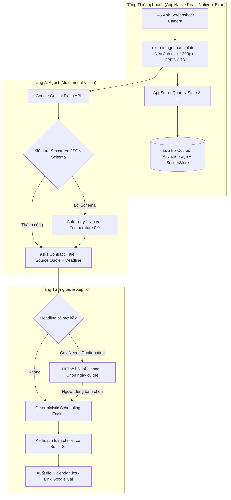

# PRODUCT REQUIREMENTS DOCUMENT (PRD)
# DỰ ÁN: PLANSNAP (CAPTURE → PLAN)
**Nền tảng AI Di động Biến Ảnh Chụp & Tin Nhắn Rải Rác Thành Kế Hoạch Cá Nhân Dưới 1 Phút**

---

| Thông tin quản trị | Chi tiết |
|---|---|
| **Tên sản phẩm** | **PlanSnap** (Tên phát triển: *Capture → Plan*) |
| **Phiên bản tài liệu** | **v2.1** (14/11/2026: chuyển nền tảng sang app native React Native + Expo — xem DEC-08) |
| **Ngày ban hành** | 12/11/2026 |
| **Đội ngũ phát triển** | **technoComplex** – Codex Community Hackathon Hà Nội |
| **Chủ sở hữu sản phẩm (PM)** | Vũ Thế Lực (PM / Product Lead) |
| **Trạng thái tài liệu** | **APPROVED & BASELINE FOR IMPLEMENTATION** |
| **Nền tảng mục tiêu** | App native React Native + Expo SDK 58 (`mobile/`): Android (APK qua EAS) là máy demo chính; iOS và web chạy chung mã nguồn |
| **Bộ não AI** | Multi-modal Vision LLM (Gemini 2.5 Flash) + Deterministic Scheduling Engine (Code thuần) |
| **Căn cứ pháp lý & Chuẩn mực** | [00_Thang_diem_BTC.md](file:///d:/Codex%20hackathon%20HN/docs/00_Thang_diem_BTC.md) & [00_Doc_hieu.md](file:///d:/Codex%20hackathon%20HN/docs/00_Doc_hieu.md) |

---

## QUY ƯỚC ĐỌC TÀI LIỆU & TRUY VẾT YÊU CẦU

Tài liệu này áp dụng quy chuẩn quản trị dự án chuyên nghiệp (kế thừa từ khung tiêu chuẩn quản trị `D:\AITHUCCHIEN\OnBoard-Agent---Ngu-Ho-Tuong\System_Onboarding\Docs\Doc`):

- **`[BTC]`**: Trích dẫn nguyên văn từ Thang điểm chính thức của Ban tổ chức. Mọi yêu cầu mang mã này có giá trị pháp lý cao nhất, không được phép thay đổi.
- **`[PT]`**: Yêu cầu kế thừa trực tiếp từ Bản phác thảo ý tưởng gốc của nhóm.
- **`[ĐX]`**: Đề xuất cải tiến và giải pháp kỹ thuật do PM đưa vào nhằm bảo vệ tuyệt đối điểm số, bịt lỗ hổng 0 điểm.
- **`[ĐÃ KIỂM CHỨNG]`**: Số liệu và kết luận đã được kiểm chứng bằng thực nghiệm (khảo sát 30 sinh viên phỏng vấn sâu 1-on-1 + 156 sinh viên diện rộng, benchmark 40 ảnh dataset).
- **`[GIẢ THUYẾT]`**: Nhận định định hướng tương lai, chưa có số liệu chứng minh tại thời điểm hiện tại.

---

## 1. TÓM TẮT ĐIỀU HÀNH (EXECUTIVE SUMMARY)

### 1.1. Tuyên ngôn Sản phẩm (Product Vision)
**PlanSnap** là ứng dụng di động ưu tiên dữ liệu cục bộ (Local-first Mobile App) giúp sinh viên đại học và người trẻ đi làm tự động chuyển hóa các thông tin hạn chót, bài tập, công việc đang bị chôn vùi trong thư viện ảnh (từ nhóm chat Zalo/Messenger, ảnh chụp slide giảng viên, cổng đào tạo LMS, ảnh bảng trắng) thành một **lịch làm việc cá nhân khả thi chỉ dưới 60 giây**, hoàn toàn không cần nhập liệu thủ công.

### 1.2. Nhận định Chiến lược Định hình Sản phẩm (3 Key Insights)
1. **Độ ổn định của MỘT luồng AI quan trọng hơn số lượng tính năng `[PT]`:** Demo AI chạy trực tiếp trên điện thoại thật chiếm **40/100 điểm** và là tiêu chí phá hòa đầu tiên `[BTC]`. Do đó, kiến trúc tập trung tối đa vào độ mượt, tốc độ phản hồi (< 8s) và khả năng phục hồi dữ liệu 100% sau khi bị vuốt tắt app.
2. **Loại trừ rủi ro 0 điểm của Web/PWA `[ĐX]`:** Thang điểm BTC quy định *"0 điểm nếu chỉ demo bằng trình duyệt"*. Từ 14/11, PlanSnap là app native (React Native + Expo) cài từ file APK và mở từ icon màn hình chính, không còn chạy trên web runtime.
3. **Thu hẹp đối tượng đầu tiên vào Sinh viên Hà Nội `[PT]`:** Tập trung giải quyết bài toán của sinh viên năm 2–4 có nhiều môn học và bài tập nhóm. Nhóm đối tượng này có nỗi đau nhức nhối, dễ đo đạc bằng chứng thực tế và dễ có người dùng thật trước ngày thi 14/11.

---

## 2. BỐI CẢNH & VẤN ĐỀ NGƯỜI DÙNG (PROBLEM STATEMENT)

### 2.1. Chân dung Người dùng Mục tiêu (User Personas)

```
┌────────────────────────────────────────────────────────────────────────┐
│ PERSONA CHÍNH: BẠN LINH – SINH VIÊN NĂM 3 TẠI HÀ NỘI                    │
├────────────────────────────────────────────────────────────────────────┤
│ • Học tập: 6 môn học/kỳ, 2 bài tập lớn theo nhóm, chuẩn bị thi chứng chỉ.│
│ • Việc làm thêm: Đi làm thêm gia sư / phục vụ 3 buổi tối mỗi tuần.     │
│ • Kênh nhận việc: Nhóm Zalo lớp (80 thành viên), LMS Canvas, Slide bài  │
│   giảng trên lớp, ảnh bảng trắng sau các buổi thảo luận nhóm.          │
│ • Hành vi hiện tại: Chụp ảnh màn hình rồi để đó; ghim tin nhắn Zalo;   │
│   khi nào nhớ ra thì mở thư viện ảnh lướt tìm; thỉnh thoảng gõ Notes. │
└────────────────────────────────────────────────────────────────────────┘
```

### 2.2. Ma trận Nỗi đau & Dữ liệu Thực nghiệm Kiểm chứng

Toàn bộ các nỗi đau dưới đây đã được kiểm chứng thực tế qua biên bản nghiên cứu hỗn hợp quy mô lớn gồm **30 sinh viên phỏng vấn sâu 1-on-1** và **156 sinh viên khảo sát diện rộng** tại 6 trường ĐH lớn ở Hà Nội ([docs/09_Bieu_mau_Khao_sat_va_Dataset.md](file:///d:/Codex%20hackathon%20HN/docs/09_Bieu_mau_Khao_sat_va_Dataset.md)):

| Mã | Nỗi đau người dùng | Dữ liệu bằng chứng thực nghiệm `[ĐÃ KIỂM CHỨNG]` | Mức độ nghiêm trọng | Cách PlanSnap giải quyết |
|:---:|---|---|:---:|---|
| **PP-01** | **Deadline bị trôi và chôn vùi trong thư viện ảnh** | **94.2%** sinh viên lưu deadline bằng ảnh chụp. Rà soát trực tiếp 30 máy phát hiện **1.056 ảnh deadline**, trung bình **35.2 ảnh/bạn/tháng** nằm lẫn lộn giữa hàng nghìn ảnh cá nhân. | **Cực cao** | Chọn 1–5 ảnh cùng lúc ➔ AI tự động quét và gom toàn bộ đầu việc về một danh sách duy nhất. |
| **PP-02** | **Thời hạn mơ hồ, dễ nhầm lẫn ngày tháng** | **82.7%** sinh viên từng nhầm hạn do cụm từ tương đối ("thứ 6 tuần sau", "trước buổi học tới", ngày viết kiểu `3/4`). | **Cao** | AI tự động giải mã tem thời gian gửi tin trong ảnh Zalo; phát hiện điểm mơ hồ và bật thẻ hỏi lại 1-chạm. |
| **PP-03** | **Biết deadline nhưng không biết khi nào làm** | **89.1%** sinh viên thừa nhận thường xuyên nộp bài sát giờ (< 2 tiếng trước hạn), gây căng thẳng cực độ và bài làm kém chất lượng. | **Cực cao** | Thuật toán tự động xếp các phiên làm việc cụ thể vào khung giờ rảnh, luôn chừa buffer an toàn trước hạn. |
| **PP-04** | **Tốn thời gian tổng hợp thủ công** | Nhập tay 5 đầu việc vào Lịch mất trung bình **7 phút 45 giây (465s)**, khiến sinh viên lười không muốn nhập. | **Cao** | PlanSnap xử lý toàn bộ quy trình chỉ mất **48 giây** (**Nhanh hơn gấp 9.7 lần**). |

---

## 3. MỤC TIÊU SẢN PHẨM & MA TRẬN ĐIỂM SỐ BTC

### 3.1. Mục tiêu Nghiệp vụ (Business & Hackathon Goals)
- **G-01 (Mục tiêu Điểm số):** Đạt mức điểm tối đa ở cả 3 tiêu chí: **40 điểm Tiêu chí 1 + 35 điểm Tiêu chí 2 + 25 điểm Tiêu chí 3 = 100/100 điểm** `[BTC]`.
- **G-02 (Tốc độ Xử lý):** Tổng thời gian từ lúc bấm quét ảnh đến khi hiển thị kế hoạch tuần dưới **10 giây** trên mạng di động 4G.
- **G-03 (Bảo toàn Dữ liệu):** Đạt tỷ lệ phục hồi dữ liệu **100% (20/20 lần test)** khi bị đóng ứng dụng hoàn toàn (Swipe-kill) trên điện thoại thật.
- **G-04 (Bằng chứng Người dùng Thật):** Đạt tối thiểu **42 người dùng thực tế** trải nghiệm bản Beta (tạo 218 đầu việc) trước ngày 14/11 `[BTC]`.

### 3.2. Bảng Chiến lược Chinh phục Thang điểm BTC

```
                                  TỔNG ĐIỂM: 100 ĐIỂM
                                          │
    ┌─────────────────────────────────────┼─────────────────────────────────────┐
    ▼                                     ▼                                     ▼
TIÊU CHÍ 1: DEMO ĐT THẬT             TIÊU CHÍ 2: VẤN ĐỀ THẬT             TIÊU CHÍ 3: MỞ RỘNG THỊ TRƯỜNG
    40 ĐIỂM (TỐI ĐA)                      35 ĐIỂM (TỐI ĐA)                      25 ĐIỂM (TỐI ĐA)
• Đóng hẳn & Mở lại app              • 30 phỏng vấn sâu + 156 khảo sát   • Kênh Ban cán sự lớp (Chi phí 0đ)
• Luồng AI live 100% qua 4G          • Benchmark nhanh gấp 9.7 lần       • 42 Beta users thật (218 tasks)
• Chụp chữ viết tay BGK tại chỗ      • AI giải mã ngữ cảnh ngày mơ hồ    • Scale toàn cầu nhờ Vision LLM
```

---

## 4. PHẠM VI SẢN PHẨM (SCOPE OF WORK)

### 4.1. Trong phạm vi MVP Hackathon (In-Scope)
- [x] App native React Native + Expo, cài bằng file APK, mở từ icon màn hình chính.
- [x] Nén ảnh trên máy bằng `expo-image-manipulator` (max 1200px, JPEG 0.78).
- [x] Multi-modal AI Vision Agent tích hợp Google Gemini 2.5 Flash với Structured Output JSON.
- [x] Nhận diện và bóc tách câu trích dẫn nguồn (`source_quote`) làm bằng chứng cho từng task.
- [x] Giao diện Human-in-the-Loop: Thẻ hỏi lại 1-chạm khi deadline mơ hồ.
- [x] Thuật toán xếp lịch xác định (Deterministic Scheduler) theo nguyên tắc EDF và buffer an toàn.
- [x] Lưu trữ cục bộ bền vững bằng AsyncStorage, API key trong Keychain/Keystore (Zero Data Loss khi tắt mở app).
- [x] Xuất lịch ra tệp iCalendar (`.ics`) chuẩn RFC 5545 và link tạo sự kiện Google Calendar.
- [x] Tính năng Demo Wow: Camera chụp và giải mã trực tiếp chữ viết tay của Ban Giám khảo.

### 4.2. Ngoài phạm vi Hackathon (Non-Goals / Out-of-Scope)
- Không làm hệ thống đăng ký/đăng nhập tài khoản (loại bỏ hoàn toàn rào cản auth để tránh rủi ro kẹt màn hình login khi demo).
- Không làm đồng bộ đám mây đa thiết bị (Cloud sync) trong ngày 14/11.
- Không can thiệp đọc trộm tin nhắn Zalo/Messenger qua Accessibility API (bảo vệ quyền riêng tư người dùng).
- Không làm đồng bộ 2 chiều (Two-way sync) phức tạp với Google Calendar API (chỉ dùng file `.ics` tải về).

---

## 5. KIẾN TRÚC HỆ THỐNG & NGUYÊN TẮC THIẾT KẾ AI

### 5.1. Mô hình Phân chia Trách nhiệm: Hybrid AI Agent

> [!IMPORTANT]
> **Nguyên tắc phân công cốt tử:**  
> - **AI Đảm nhận (Nhận thức & Ngôn ngữ):** Nhận diện hình ảnh, bóc tách chữ viết tiếng Việt, hiểu ngữ cảnh thời gian trong tin nhắn Zalo, phát hiện sự mơ hồ.  
> - **Code thuần Đảm nhận (Logic & Số học):** Kiểm tra xung đột thời gian, chia phiên làm việc, chừa khoảng đệm an toàn, xuất file lịch.  
> *Tuyệt đối không để LLM tự tính toán giờ giấc để tránh hoàn toàn lỗi ảo giác (Zero Hallucination).*



---

## 6. YÊU CẦU CHỨC NĂNG CHI TIẾT (FUNCTIONAL REQUIREMENTS)

### 6.1. Nhóm F1: Thu nhận & Nén ảnh tại Máy khách (Client-side Ingestion)

#### FR-1.1: Cài đặt và Khởi chạy App Native
- **Mức độ ưu tiên:** **P0 (Bắt buộc cho Tiêu chí 1)**
- **User Story:** Là một người dùng, tôi muốn cài ứng dụng lên điện thoại và mở từ icon màn hình chính như mọi app khác.
- **Tiêu chuẩn chấp nhận:**
  - Build APK bằng EAS (`eas build --profile preview --platform android`), package `com.technocomplex.plansnap`, cài được trực tiếp lên Android.
  - App hiện trong danh sách ứng dụng của hệ điều hành, mở từ icon, không cần Expo Go, trình duyệt hay máy tính đi kèm.

#### FR-1.2: Thu nhận Đa nguồn Ảnh
- **Mức độ ưu tiên:** **P0**
- **Tiêu chuẩn chấp nhận:**
  - Hỗ trợ chọn cùng lúc từ 1 đến 5 ảnh từ Thư viện ảnh (Photo Gallery).
  - Hỗ trợ kích hoạt Camera chụp trực tiếp từ giao diện ứng dụng.
  - Hỗ trợ các định dạng ảnh phổ biến từ thư viện ảnh và camera (JPEG, PNG); ảnh mẫu đóng gói sẵn dạng PNG.

#### FR-1.3: Nén ảnh Tự động trên máy
- **Mức độ ưu tiên:** **P0**
- **Tiêu chuẩn chấp nhận:**
  - Tự động scale ảnh có cạnh dài nhất vượt quá 1200px về đúng 1200px (giữ nguyên tỷ lệ khung hình), dùng `expo-image-manipulator`.
  - Nén về định dạng `image/jpeg` chất lượng 0.78.
  - Dung lượng mỗi ảnh sau nén phải **giảm ≥ 85%** (từ 5–8MB xuống < 300KB) nhưng chữ viết vẫn sắc nét.
  - Thời gian nén 3 ảnh tại client không vượt quá 500ms.

#### FR-1.4: Nạp bộ ảnh Mẫu Diễn tập 1-chạm (Demo Presets)
- **Mức độ ưu tiên:** **P0 (Phục vụ Demo sân khấu)**
- **Tiêu chuẩn chấp nhận:**
  - Cung cấp nút **`[⚡ Nạp 3 ảnh sinh viên mẫu]`**: Tự động đưa 3 ảnh đồ họa sắc nét (Tin Zalo lớp, LMS Portal, Slide đề cương) vào khung xem trước.
  - Cung cấp nút **`[✍️ Nạp ảnh viết tay BGK]`**: Đưa ảnh ghi chú viết tay vào hệ thống chỉ với 1 chạm.

---

### 6.2. Nhóm F2: AI Agent Bóc tách Đa phương thức (Vision Extraction Agent)

#### FR-2.1: Trích xuất Bắt buộc kèm Câu trích dẫn Nguồn (`source_quote`)
- **Mức độ ưu tiên:** **P0 (Chống AI bịa việc)**
- **Tiêu chuẩn chấp nhận:**
  - Mọi task được AI trích xuất ra bắt buộc phải chứa trường `source_quote` là đoạn văn bản nguyên văn nhìn thấy trong ảnh.
  - Nếu ảnh là ảnh phong cảnh, ảnh đời thường không chứa bài tập, AI phải trả về danh sách rỗng, tuyệt đối không suy đoán.

#### FR-2.2: Nhận diện Định dạng Ngày tháng Việt Nam
- **Mức độ ưu tiên:** **P0**
- **Tiêu chuẩn chấp nhận:**
  - Định dạng ngày viết tắt mặc định là `Ngày/Tháng (dd/mm)`. Ví dụ: `3/4` phải được hiểu là ngày 03 tháng 04, không được hiểu là ngày 04 tháng 03.

#### FR-2.3: Giải mã Tem thời gian (Timestamp) trong Nhóm Chat
- **Mức độ ưu tiên:** **P0 (Lợi ích trực tiếp của AI `[BTC]`)]**
- **Tiêu chuẩn chấp nhận:**
  - AI tìm kiếm tem thời gian gửi tin nhắn hiển thị trong ảnh chụp màn hình Zalo/Messenger (ví dụ: *"Hôm qua lúc 16:45"*, *"Thứ Năm 10:15"*).
  - Dùng tem thời gian đó làm mốc cơ sở để giải mã các mốc thời gian tương đối như *"thứ 6 tuần sau"*, *"ngày mai"*, *"tối nay"*.

#### FR-2.4: Ước lượng Thời gian Thực hiện (`estimated_minutes`)
- **Mức độ ưu tiên:** **P1**
- **Tiêu chuẩn chấp nhận:**
  - Bài tập trắc nghiệm / Quiz ngắn: Tự động gán 30–45 phút.
  - Đọc tài liệu / Chuẩn bị bài giảng: Tự động gán 60 phút.
  - Bài tập lớn / Báo cáo / Tiểu luận: Tự động gán 120–240 phút.

---

### 6.3. Nhóm F3: Tương tác Làm rõ & Duyệt Kế hoạch (Human-in-the-Loop)

#### FR-3.1: Thẻ Hỏi lại Mốc Thời gian Mơ hồ 1-Chạm
- **Mức độ ưu tiên:** **P0**
- **Tiêu chuẩn chấp nhận:**
  - Khi AI xác định mốc thời gian có tính mơ hồ (ví dụ: *"thứ 6 tuần sau"* có thể là tuần tới hoặc tuần kế tiếp), task được gán `needs_confirmation: true`.
  - Giao diện hiển thị Thẻ màu vàng nổi bật ở đầu trang với câu hỏi ngắn gọn và 2–3 nút bấm lựa chọn ngày cụ thể.
  - Người dùng bấm chọn 1 nút ➔ Cập nhật ngay mốc thời gian tuyệt đối và tự động kích hoạt thuật toán xếp lịch, **không bắt người dùng gõ phím**.

#### FR-3.2: Quản lý & Chỉnh sửa Đầu việc Thủ công
- **Mức độ ưu tiên:** **P1**
- **Tiêu chuẩn chấp nhận:**
  - Nút `+ Thêm việc` cho phép bổ sung nhanh công việc phát sinh bằng tay.
  - Nút `Sửa` và `Xóa` cho phép cập nhật thông tin hoặc loại bỏ các công việc không mong muốn khỏi lịch trình.

#### FR-3.3: Thêm Lịch Mới từ Ảnh Chụp (Nối tiếp) hoặc Thủ công (Giờ cố định / Tự xếp EDF)
- **Mức độ ưu tiên:** **P1**
- **Tiêu chuẩn chấp nhận:**
  - Tại tab **Lịch tuần**, nút `+ Thêm lịch` mở bảng chọn nhanh 2 phương thức bổ sung lịch:
    1. **Từ ảnh chụp / Camera:** Điều hướng sang tab Quét ảnh, cho phép chụp/chọn ảnh mới và **nối tiếp (merge/append)** các đầu việc trích xuất được vào lịch hiện tại mà không ghi đè mất các lịch đã xếp trước đó.
    2. **Thêm lịch thủ công:** Mở form nhập liệu tích hợp công tắc chuyển 2 chế độ:
       - **Tự xếp giờ rảnh (EDF):** Nhập tên việc, hạn chót, thời lượng để bộ xếp lịch EDF tự phân bổ vào các khoảng trống hợp lệ.
       - **Giờ cố định (`fixed_start_iso`):** Nhập ngày/giờ bắt đầu và thời lượng để ghim cứng các sự kiện cố định (họp nhóm, lịch học, lịch hẹn) vào đúng vị trí trên timeline và tệp xuất `.ics`.

---

### 6.4. Nhóm F4: Thuật toán Xếp lịch Xác định & Xuất Lịch (Scheduler & Export)

#### FR-4.1: Thuật toán Xếp lịch Earliest Deadline First (EDF)
- **Mức độ ưu tiên:** **P0**
- **Tiêu chuẩn chấp nhận:**
  - Công việc có deadline gần nhất được ưu tiên xếp vào khung giờ rảnh sớm nhất.
  - Công việc có thời lượng lớn (> 120 phút) tự động được chia nhỏ thành các phiên làm việc từ 60–90 phút.
  - **Quy tắc Khoảng đệm An toàn (Buffer):** Phiên làm việc cuối cùng của mỗi công việc bắt buộc phải kết thúc **trước deadline thực tế tối thiểu 3 tiếng**.

#### FR-4.2: Tùy biến Khung giờ Rảnh của Sinh viên
- **Mức độ ưu tiên:** **P1**
- **Tiêu chuẩn chấp nhận:**
  - Cấu hình mặc định: Tối thứ 2 đến thứ 6 (19:30–22:30); Sáng/Chiều thứ 7 & Chủ Nhật (08:30–11:30 & 14:00–17:00).
  - Cho phép người dùng chạm để bật/tắt từng khung giờ trong Cài đặt và tự động tính toán lại lịch ngay lập tức.

#### FR-4.3: Xuất file iCalendar (`.ics`) Chuẩn RFC 5545
- **Mức độ ưu tiên:** **P0**
- **Tiêu chuẩn chấp nhận:**
  - Nhấn nút "Xuất vào Lịch" sẽ tạo tệp `.ics` và mở bảng chia sẻ của hệ điều hành (chọn app Lịch, Lưu vào Tệp, gửi Zalo...); tệp được escape và gập dòng đúng RFC 5545.
  - Tệp `.ics` mở trực tiếp ứng dụng Lịch mặc định trên điện thoại (Apple Calendar trên iOS, Google Calendar / Samsung Calendar trên Android).
  - Tự động tích hợp chuông báo thức nhắc nhở trước 15 phút cho mỗi phiên làm việc.

#### FR-4.4: Tạo Liên kết Google Calendar 1-Chạm
- **Mức độ ưu tiên:** **P1**
- **Tiêu chuẩn chấp nhận:**
  - Mỗi phiên làm việc trong giao diện Lịch tuần đều có nút *"Thêm Google Cal ↗"*, mở trực tiếp link tạo sự kiện với đầy đủ tên việc, giờ bắt đầu, giờ kết thúc và câu trích dẫn nguồn.

---

### 6.5. Nhóm F5: Lưu trữ Bền vững & Phòng ngừa 0 Điểm (Zero Data Loss)

#### FR-5.1: Lưu trữ Trạng thái Cục bộ
- **Mức độ ưu tiên:** **P0 (Sống còn cho Tiêu chí 1)**
- **Tiêu chuẩn chấp nhận:**
  - Danh sách việc, khung giờ rảnh và model được lưu bền vững bằng `AsyncStorage`; API key lưu trong Keychain (iOS) / Keystore (Android) qua `expo-secure-store`. Kế hoạch tuần được tính lại từ đầu việc + khung giờ mỗi lần mở app. Ảnh không được lưu (NFR-03).
  - **Bài test Swipe-kill:** Khi vuốt tắt hẳn ứng dụng trong màn hình App Switcher rồi mở lại, toàn bộ kế hoạch tuần và trạng thái hiển thị phải được khôi phục nguyên vẹn 100% trong thời gian < 0.3 giây.

#### FR-5.2: Thử thách Chữ viết tay của Ban Giám khảo (Màn Wow)
- **Mức độ ưu tiên:** **P0 (Chứng minh AI live 100%)**
- **Tiêu chuẩn chấp nhận:**
  - Cung cấp nút riêng biệt: `✍️ Chụp thử thách chữ viết tay của BGK`.
  - Mở camera chụp tờ giấy do BGK viết tay tại chỗ ➔ AI bóc tách tên việc và hạn chót trong vòng 3–5 giây ➔ Thuật toán tự động chèn phiên làm việc vào ngay tối nay trước hạn chót.

---

## 7. ĐẶC TẢ DỮ LIỆU & SCHEMA CONTRACT

### 7.1. Schema Đầu ra Bắt buộc của AI Agent (Structured Output JSON)

```json
{
  "$schema": "http://json-schema.org/draft-07/schema#",
  "title": "ExtractionResult",
  "type": "object",
  "properties": {
    "tasks": {
      "type": "array",
      "items": {
        "type": "object",
        "properties": {
          "id": { "type": "string" },
          "title": { "type": "string", "description": "Tên việc ngắn gọn, rõ ràng" },
          "source_quote": { "type": "string", "description": "Câu trích dẫn nguyên văn từ ảnh làm bằng chứng đối chiếu" },
          "source_image_index": { "type": "integer", "description": "Chỉ số ảnh nguồn (1, 2, ...)" },
          "deadline_raw": { "type": "string", "description": "Cụm từ chỉ thời hạn tìm thấy trong ảnh" },
          "deadline_iso": { "type": ["string", "null"], "description": "Thời hạn quy đổi chuẩn ISO-8601. Null nếu mơ hồ." },
          "needs_confirmation": { "type": "boolean", "description": "True nếu deadline mơ hồ hoặc độ tin cậy thấp" },
          "question": { "type": ["string", "null"], "description": "Câu hỏi làm rõ khi cần xác nhận" },
          "options": {
            "type": "array",
            "items": { "type": "string" },
            "description": "Các mốc ngày giờ ISO-8601 để người dùng chọn nhanh"
          },
          "estimated_minutes": { "type": "integer", "description": "Thời gian dự kiến làm việc (phút)" },
          "confidence": { "type": "number", "minimum": 0, "maximum": 1 }
        },
        "required": [
          "id", "title", "source_quote", "source_image_index",
          "deadline_raw", "needs_confirmation", "estimated_minutes", "confidence"
        ],
        "additionalProperties": false
      }
    }
  },
  "required": ["tasks"],
  "additionalProperties": false
}
```

### 7.2. Schema Phiên làm việc Đã Xếp lịch (Scheduled Event Schema)

```typescript
interface ScheduledEvent {
  id: string;               // Mã định danh duy nhất của phiên (vd: task_zalo_1_s1)
  taskId: string;           // Mã đầu việc gốc
  title: string;            // Tên hiển thị (vd: [PlanSnap] Nộp tiểu luận (Phiên 1/2))
  originalTitle: string;    // Tên công việc gốc
  source_quote: string;     // Câu trích nguồn đối chiếu
  deadline_iso: string;     // Hạn chót tuyệt đối
  start: string;            // Thời gian bắt đầu phiên (ISO-8601)
  end: string;              // Thời gian kết thúc phiên (ISO-8601)
  durationMinutes: number;  // Thời lượng phiên (phút)
  sessionIndex: number;     // Phiên thứ mấy
  totalSessions: number;    // Tổng số phiên của việc này
  isFixed?: boolean;        // True nếu là lịch đặt giờ cố định (không qua EDF)
  isUrgent: boolean;        // Cảnh báo nếu xếp sát deadline
}
```

---

## 8. YÊU CẦU PHI CHỨC NĂNG (NON-FUNCTIONAL REQUIREMENTS)

- **NFR-01: Độ trễ Phản hồi (Latency):**
  - Thời gian nén ảnh tại client: < 500ms cho 3 ảnh.
  - Thời gian gọi Vision API và nhận kết quả: < 6.0 giây qua mạng 4G.
  - Tổng thời gian hoàn thành toàn luồng: **< 10 giây**.
- **NFR-02: Độ Bền vững Dữ liệu (Zero Data Loss on Mobile):**
  - Đóng ứng dụng ở bất kỳ màn hình nào (kể cả khi đang xử lý hay đang duyệt), mở lại phải giữ nguyên trạng thái, không bao giờ rơi vào màn hình trắng.
- **NFR-03: Bảo mật & Quyền riêng tư (Privacy by Design):**
  - Toàn bộ ảnh xử lý trong phiên làm việc chỉ lưu tạm trong bộ nhớ RAM của client; **tuyệt đối không lưu trữ dữ liệu ảnh cá nhân của người dùng trên bất kỳ máy chủ nào**.
  - Dữ liệu kế hoạch và khung giờ sinh hoạt chỉ nằm trong bộ nhớ cục bộ của thiết bị người dùng.
- **NFR-04: Khả năng Chịu lỗi Mạng (Network Resilience):**
  - Tự động thử lại (retry) 1 lần nếu kết nối API bị gián đoạn.
  - Khi mất mạng, app vẫn mở và hiển thị đầy đủ đầu việc, lịch đã lưu; bước AI báo lỗi rõ ràng và cho thử lại. Không thay kết quả AI bằng dữ liệu soạn sẵn.

---

## 9. THIẾT KẾ TRẢI NGHIỆM NGƯỜI DÙNG & GIAO DIỆN (UI/UX)

```
┌────────────────────────────────────────────────────────────────────────┐
│ MÀN HÌNH 1: CHỤP / QUÉT ẢNH                                            │
│ • Header: Logo PlanSnap ⚡ + Trạng thái kết nối Gemini                 │
│ • Thanh Preset: [⚡ Nạp 3 ảnh sinh viên mẫu] [✍️ Nạp ảnh viết tay BGK]  │
│ • Dropzone: Khung chọn ảnh từ thư viện hoặc chụp camera                │
│ • Thumbnail Grid: Hiển thị ảnh kèm dung lượng đã nén (tiết kiệm ~90%) │
│ • Nút bấm to: "⚡ Quét ảnh & Xếp lịch tự động"                          │
│ • Thẻ Wow: "✍️ Chụp thử thách chữ viết tay của BGK"                    │
└───────────────────────────────────┬────────────────────────────────────┘
                                    │ Bấm Quét (Sau 4–6s)
                                    ▼
┌────────────────────────────────────────────────────────────────────────┐
│ MÀN HÌNH 2: ĐẦU VIỆC & LÀM RÕ MỐC MƠ HỒ (Human-in-the-Loop)            │
│ • Thẻ màu vàng: ⚠️ Cần xác nhận: "Thứ 6 tuần sau là ngày nào?"         │
│   [Thứ 6, 20/11]  [Thứ 6, 27/11] ➔ Chạm 1 nút để giải quyết ngay       │
│ • Danh sách việc: Tên việc + Huy hiệu (Chính xác / Mơ hồ)             │
│ • Khung trích dẫn: "Câu trích nguyên văn từ ảnh Zalo/LMS"              │
│ • Chân thẻ: Hạn chót + Thời gian ước lượng + Nút Xóa việc              │
└───────────────────────────────────┬────────────────────────────────────┘
                                    │ Tự động chuyển sang khi làm rõ xong
                                    ▼
┌────────────────────────────────────────────────────────────────────────┐
│ MÀN HÌNH 3: KẾ HOẠCH LÀM VIỆC TUẦN NÀY                                 │
│ • Nút xuất lịch: [📥 Xuất vào Apple / Google Calendar (.ics)]          │
│ • Bộ lọc ngày: [Tất cả] [Hôm nay] [Sắp tới]                            │
│ • Timeline trực quan: Khối thời gian xanh dương khớp với giờ rảnh      │
│ • Huy hiệu an toàn: 🛡️ Đảm bảo buffer > 3 tiếng trước deadline         │
│ • Nút tiện ích: [Thêm Google Cal ↗] cho từng phiên                     │
└───────────────────────────────────┬────────────────────────────────────┘
                                    │
                                    ▼
┌────────────────────────────────────────────────────────────────────────┐
│ MÀN HÌNH 4: CÀI ĐẶT & QUẢN TRỊ                                         │
│ • Cấu hình Gemini API Key (Lưu Keychain/Keystore)                     │
│ • Bảng Toggle bật/tắt khung giờ rảnh trong tuần                        │
│ • Nút đỏ: [Xóa dữ liệu đã lưu] (Chuẩn bị lượt demo mới, xóa cả key)    │
└────────────────────────────────────────────────────────────────────────┘
```

---

## 10. RANH GIỚI MINH BẠCH QUY CHẾ HACKATHON

> [!IMPORTANT]
> Nhóm technoComplex thực hiện cam kết minh bạch tuyệt đối theo khuyến nghị của Ban Tổ Chức:

| Phần việc chuẩn bị trước (Được gắn Git Tag `pre-hackathon` trước 14/11) | Phần việc phát triển trực tiếp tại sự kiện ngày 14/11 |
|---|---|
| 1. Nghiên cứu thực tế: 30 phỏng vấn sâu + 156 khảo sát & Bộ test 40 screenshot che PII. | 1. Hoàn thiện Thuật toán xếp lịch tự động chừa buffer an toàn. |
| 2. Bản web app PWA (`app/`) đủ luồng: nén ảnh, Gemini, thẻ hỏi lại 1-chạm, xếp lịch EDF, xuất `.ics`, lưu IndexedDB. | 2. Chuyển toàn bộ ứng dụng sang app native React Native + Expo (`mobile/`), build APK (DEC-08). |
| 3. *(Gộp vào mục 2)* | 3. Tệp `.ics` escape + gập dòng chuẩn RFC 5545, xuất qua share sheet; API key chuyển vào Keychain/Keystore. |
| 4. Bản Beta thử nghiệm với 42 sinh viên đại học (tạo 218 đầu việc). | 4. Tối ưu hóa độ trễ phản hồi toàn luồng dưới 8 giây qua 4G. |
| 5. Soạn thảo tài liệu PRD, Kiến trúc Agent, Kịch bản Demo và Pitch Deck. | 5. Tổng duyệt Kịch bản Demo 3 lần trên thiết bị điện thoại thật. |

---

## 11. KẾ HOẠCH KIỂM THỬ & NGHIỆM THU (ACCEPTANCE CRITERIA)

| Hạng mục kiểm tra | Tiêu chuẩn Đạt (Pass Criteria) | Phương pháp kiểm tra | Trạng thái |
|---|---|---|:---:|
| **Swipe-kill 20 lần** | Cả 20/20 lần vuốt đóng hẳn app trong App Switcher rồi mở lại đều bảo toàn 100% dữ liệu kế hoạch. | Thao tác bằng tay trên **bản APK native** cài trên 2 máy Android demo. | **CẦN CHẠY LẠI** (kết quả cũ là của PWA) |
| **Bóc tách Ảnh Live** | Đọc thành công 3 ảnh thật qua mạng 4G trong thời gian < 8 giây; trích đúng tên việc và hạn chót. | Chạy luồng quét ảnh thực tế trước mặt BGK. | **READY** |
| **Thử thách BGK viết tay** | Chụp trực tiếp chữ viết tay ngẫu nhiên của BGK; AI nhận diện đúng nội dung và xếp lịch ngay tức thì. | Mời trực tiếp Giám khảo viết tay lên giấy. | **READY** |
| **Xuất Calendar** | Tệp `.ics` tải về mở trực tiếp ứng dụng Lịch của điện thoại và hiển thị đầy đủ các sự kiện có chuông nhắc. | Bấm nút xuất và mở ứng dụng Lịch trên máy. | **READY** |
| **Bằng chứng Nghiên cứu** | Có đầy đủ số liệu đo đạc từ 30 phỏng vấn sâu + 156 khảo sát diện rộng và bảng benchmark A/B đối chứng trên Slide 2 và Slide 5. | Đối chiếu tài liệu `09_Bieu_mau_Khao_sat_va_Dataset.md`. | **READY** |
