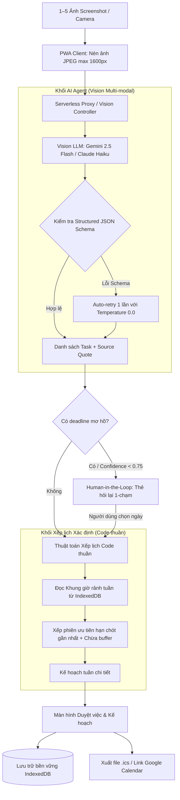

# KIẾN TRÚC AGENT & THIẾT KẾ AI: PlanSnap
**Hệ thống AI Agent bóc tách đa phương thức & Bộ điều phối lịch trình xác định**

| | |
|---|---|
| **Hệ thống** | **PlanSnap Agent Core** |
| **Phiên bản** | v1.0 (Hackathon Release Candidate) |
| **Ngày lập** | 12/11/2026 |
| **Đội ngũ** | **technoComplex** – Codex Community Hackathon Hà Nội |
| **Tài liệu căn cứ** | [00_Thang_diem_BTC.md](file:///d:/Codex%20hackathon%20HN/docs/00_Thang_diem_BTC.md) & [01_PRD.md](file:///d:/Codex%20hackathon%20HN/docs/01_PRD.md) |
| **Công nghệ lõi** | Vision Multi-modal LLM (Structured Outputs) + Deterministic Code Scheduler |

---

## 1. Triết lý thiết kế: Hybrid AI Agent (LLM + Code thuần)

> [!IMPORTANT]
> **Quyết định kiến trúc sống còn để đạt 40 điểm Tiêu chí 1:**  
> Không để LLM tự tính toán và xếp lịch trình!  
> - **LLM đảm nhận:** Đọc ảnh thị giác, hiểu ngôn ngữ tiếng Việt tự nhiên, giải mã ngữ cảnh tem thời gian gửi tin nhắn, trích xuất cấu trúc và phát hiện điểm mơ hồ (Nơi AI vượt trội con người và code regex).
> - **Code thuần đảm nhận:** Thuật toán xếp lịch xác định (Earliest Deadline First, kiểm tra va chạm khung giờ, chừa buffer an toàn, phân chia phiên làm việc). Code thuần bảo đảm độ chính xác 100%, không bị ảo giác (zero hallucination), tốc độ thực thi < 5ms và giải thích minh bạch trước Ban Giám khảo.



---

## 2. Đặc tả các Công cụ của Agent (Tool Contracts)

Hệ thống hoạt động theo mô hình điều phối hướng công cụ (Tool-driven Agent):

### 2.1. Tool 1: `extract_tasks_from_images`
- **Mục đích:** Đọc danh sách ảnh, trích xuất tất cả đầu việc, deadline và bằng chứng nguồn.
- **Đầu vào (Parameters):**
  - `images`: Mảng các chuỗi Base64 hoặc URL blob của ảnh (đã nén).
  - `client_current_time`: Thời gian hiện tại của thiết bị (chuỗi ISO-8601, vd: `2026-11-14T09:30:00+07:00`).
  - `timezone`: Múi giờ thiết bị (mặc định `Asia/Ho_Chi_Minh`).
- **Đầu ra (Return Contract):** Đối tượng JSON tuân thủ nghiêm ngặt schema dưới đây.

```json
{
  "tasks": [
    {
      "id": "task_01",
      "title": "Nộp báo cáo tiến độ môn Kinh tế lượng",
      "source_quote": "Hạn cuối nộp file docx lên LMS là 23h59 thứ 6 tuần sau nha cả lớp",
      "source_image_index": 1,
      "deadline_raw": "23h59 thứ 6 tuần sau",
      "deadline_iso": "2026-11-20T23:59:00+07:00",
      "needs_confirmation": true,
      "question": "Thứ 6 tuần sau là ngày 20/11 hay 27/11?",
      "options": ["2026-11-20T23:59:00+07:00", "2026-11-27T23:59:00+07:00"],
      "estimated_minutes": 120,
      "confidence": 0.82
    }
  ]
}
```

### 2.2. Tool 2: `clarify_ambiguity` (Human-in-the-Loop)
- **Mục đích:** Kích hoạt giao diện hỏi lại tức thời khi deadline không rõ ràng hoặc thiếu thông tin thời gian.
- **Hành vi:**
  - Nếu `needs_confirmation == true`, UI tự động hiển thị thanh banner nổi với câu hỏi ngắn và 2–3 nút chọn nhanh.
  - Tuyệt đối không bắt người dùng nhập bàn phím để giữ tốc độ demo dưới 5 giây.
  - Sau khi người dùng chạm chọn, cập nhật trực tiếp trường `deadline_iso` của task tương ứng và gán `needs_confirmation = false`.

### 2.3. Tool 3: `deterministic_schedule` (Code thuần)
- **Mục đích:** Xếp các task đã làm rõ vào các khung giờ rảnh trong tuần.
- **Quy tắc thuật toán:**
  1. **Sắp xếp thứ tự ưu tiên:** Task có `deadline_iso` gần nhất được xếp trước (Earliest Deadline First - EDF).
  2. **Chia nhỏ task lớn:** Nếu `estimated_minutes > 120`, tự động tách thành các phiên (sessions) từ 60–90 phút (vd: Task 180 phút chia thành Phiên 1: 90p và Phiên 2: 90p).
  3. **Phân bổ vào khung rảnh:** Quét danh sách slot rảnh trong tuần từ `user_availability`.
  4. **Quy tắc chừa khoảng đệm (Safety Buffer):** Phiên làm việc cuối cùng của một task bắt buộc phải kết thúc **trước deadline tối thiểu 3 tiếng** (tránh tình trạng vừa làm xong là hết giờ).
  5. **Kiểm tra va chạm (Collision Detection):** Không xếp 2 phiên làm việc trùng giờ nhau.

### 2.4. Tool 4: `generate_icalendar`
- **Mục đích:** Đóng gói toàn bộ các phiên làm việc thành tệp `.ics` chuẩn iCalendar RFC 5545.
- **Đặc tả Event:**
  - `SUMMARY`: Tên đầu việc (kèm số phiên nếu bị chia nhỏ, vd: `[PlanSnap] Nộp báo cáo KTL (Phiên 1/2)`).
  - `DESCRIPTION`: Trích dẫn bằng chứng gốc (`Nguồn: "Hạn cuối nộp file docx..."`) + Ghi chú deadline gốc.
  - `DTSTART` & `DTEND`: Giờ bắt đầu và kết thúc chuẩn UTC / Local time.
  - `ALARM`: Tự động đặt thông báo nhắc trước 15 phút trước mỗi phiên.

---

## 3. Thiết kế System Prompt cho Vision LLM

Prompt được tối ưu hóa đặc thù cho ngôn ngữ tiếng Việt học đường và thói quen sinh viên:

```markdown
VAI TRÒ:
Bạn là Chuyên gia trích xuất kế hoạch học tập của ứng dụng PlanSnap.
Nhiệm vụ của bạn là đọc các hình ảnh được cung cấp (ảnh chụp màn hình Zalo, Messenger, giao diện LMS, ảnh chụp slide, bảng trắng hoặc chữ viết tay) và trích xuất tất cả các đầu việc học tập, bài tập, hạn chót cần thực hiện.

THỜI GIAN THAM CHIẾU HIỆN TẠI CỦA NGƯỜI DÙNG:
{{client_current_time}} (Múi giờ: {{timezone}})

CÁC NGUYÊN TẮC BẮT BUỘC:
1. NGUYÊN TẮC BẰNG CHỨNG THỰC TẾ (CHỐNG BỊA VIỆC):
   - Mọi đầu việc (task) trích xuất ra BẮT BUỘC phải có đoạn văn bản trích dẫn nguyên văn từ ảnh trong trường "source_quote".
   - Nếu một hình ảnh chỉ là ảnh đời thường hoặc không chứa bất kỳ hạn chót/bài tập nào, TUYỆT ĐỐI KHÔNG tự bịa ra công việc. Hãy bỏ qua ảnh đó.

2. QUY TẮC ĐỊNH DẠNG NGÀY THÁNG VIỆT NAM:
   - Ở Việt Nam, định dạng ngày tháng viết tắt mặc định là Ngày/Tháng (dd/mm). Ví dụ: "3/4" hoặc "03/04" là ngày 03 tháng 04, không được hiểu là 04 tháng 03.

3. XỬ LÝ HẠN CHÓT TƯƠNG ĐỐI & TEM THỜI GIAN TIN NHẮN:
   - Hãy tìm tem thời gian gửi tin nhắn (timestamp) xuất hiện trong ảnh chụp màn hình Zalo/Messenger (ví dụ: "Hôm qua lúc 14:20", "Thứ Năm 10:15").
   - Dùng tem thời gian đó làm mốc tham chiếu để suy luận các cụm từ tương đối như "thứ 6 tuần sau", "ngày mai", "tối nay".
   - Nếu không tìm thấy tem thời gian trong ảnh, mới dùng {{client_current_time}}.

4. PHÁT HIỆN SỰ MƠ HỒ (AMBIGUITY DETECTION):
   - Nếu cụm từ thời hạn gây tranh cãi (ví dụ: "thứ 6 tuần sau" có thể hiểu là thứ 6 của tuần kế tiếp hoặc tuần sau nữa), hãy:
     + Đặt "needs_confirmation": true
     + Điền "question": Câu hỏi làm rõ ngắn gọn
     + Điền "options": 2 mốc thời gian ISO-8601 cụ thể để người dùng bấm chọn nhanh.
   - Nếu thời hạn rõ ràng (ví dụ: "23h59 ngày 20/11/2026"):
     + Đặt "needs_confirmation": false
     + Điền "deadline_iso": chuỗi ISO-8601 chuẩn.

5. ƯỚC LƯỢNG THỜI GIAN THỰC HIỆN (estimated_minutes):
   - Bài tập trắc nghiệm ngắn / Quiz: 30 - 45 phút.
   - Đọc tài liệu / Chuẩn bị bài trước lớp: 60 phút.
   - Làm bài tập lớn / Viết tiểu luận / Báo cáo: 120 - 240 phút.
   - Họp nhóm: 60 - 90 phút.

ĐẦU RA:
Bắt buộc trả về đúng định dạng JSON Schema của Structured Outputs, không kèm lời giải thích râu ria ngoài JSON.
```

---

## 4. Chiến lược Tối ưu hóa Độ trễ (Latency Optimization)

Để bảo đảm màn demo trên sân khấu diễn ra dưới 10 giây (tránh bị BGK đánh giá là "chạy một phần hoặc chưa ổn định" - mất 20 điểm):

1. **Client-side Compression (Canvas API):**
   - Kích thước ảnh gốc chụp bằng điện thoại thường từ 3000x4000px (5–12MB).
   - Trước khi gửi đi, PWA dùng HTML5 Canvas nén ảnh về cạnh dài tối đa 1600px, định dạng `image/jpeg` với chất lượng 0.8.
   - Dung lượng giảm 95% xuống còn khoảng 200–350KB. Thời gian upload qua 4G giảm từ 8 giây xuống còn 0.8 giây.
2. **Chọn Model phù hợp:**
   - Ưu tiên 1: **Google Gemini 2.5 Flash** (Tốc độ đọc thị giác cực nhanh, hỗ trợ đa ảnh xuất sắc, độ trễ ~2–4 giây cho 3 ảnh).
   - Ưu tiên 2: **Claude 3.5 Haiku** (Nếu Gemini bị rate-limit).
3. **Cấu hình Model:**
   - `temperature: 0.0` (Bảo đảm tính xác định, tốc độ sinh token nhanh nhất và không hallucination).
   - `max_output_tokens: 1500`.

---

## 5. Chiến lược Phòng vệ & Xử lý sự cố (Fail-Safe Protocol)

| Tình huống sự cố | Hậu quả tiềm tàng | Cơ chế phòng vệ tự động của Agent |
|---|---|---|
| **JSON trả về sai định dạng Schema** | Crash ứng dụng, màn hình trắng | Bọc bằng khối `try/catch`. Nếu JSON parse lỗi, tự động trích xuất chuỗi JSON bằng regex `\{[\s\S]*\}`. Nếu vẫn lỗi, gọi lại Vision API lần 2 ngay lập tức với prompt rút gọn. |
| **Sóng 4G chập chờn / Timeout > 15s** | Treo màn hình demo | Timeout client đặt ở mức 15 giây. Nếu timeout, hiển thị thông báo thân thiện *"Mạng đang chậm, chạm để thử lại"* kèm thanh tiến trình. Không để ứng dụng bị đóng băng. |
| **Ảnh chụp quá mờ / Chữ viết tay BGK khó đọc** | AI đoán mò hoặc báo không có việc | AI trả về task với `confidence: 0.5`, kèm cờ `needs_confirmation: true`. Ứng dụng hiển thị ô cho phép người dùng hoặc BGK bấm xác nhận nhanh tên việc. |
| **Đóng hẳn app giữa chừng** | Mất kết quả vừa bóc tách | Ngay khi nhận được JSON từ API, client commit ngay lập tức vào IndexedDB trước khi render giao diện. Dù có bị vuốt tắt app ngay lúc đó, mở lại vẫn hiển thị kết quả. |

